# Carte du réseau des compétences — collège (6e–3e)

> **Généré** par `scripts/generate-learning-net-map.mjs` — ne pas éditer à la main.
> Contrat et règles : [`docs/architecture/LEARNING_NET.md`](../architecture/LEARNING_NET.md).
> Données : `packages/core/curriculum/fr/net/`.

**108** items du programme officiel · **15** séquences · **17** fils conceptuels · **113** liens (9 consolidates, 78 requires, 26 extends) · **6** leçons publiées · **54** leçons prévues (13 unités).

Légende des liens : `requires` (requiert) — prérequis, lien de révision ; `extends` (prolonge) — même notion plus loin dans la spirale, la leçon n’enseigne QUE la valeur ajoutée ; `consolidates` (consolide) — le programme répète l’item, la leçon le rappelle sans le reconstruire.

## 1. Les fils conceptuels (la spirale, classe par classe)

### Divisibilité, nombres premiers — `divisibilite`

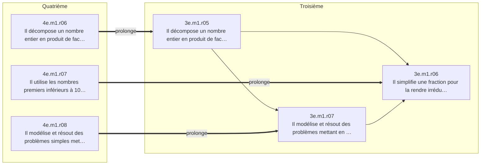

### Fractions, nombres rationnels — `fractions-rationnels`

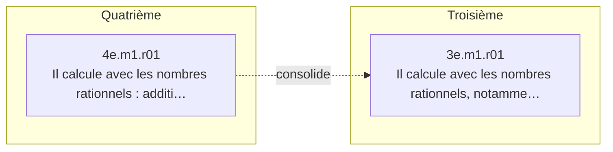

Prérequis venus d’autres fils : `3e.m1.r06`.

### Puissances, notation scientifique — `puissances`

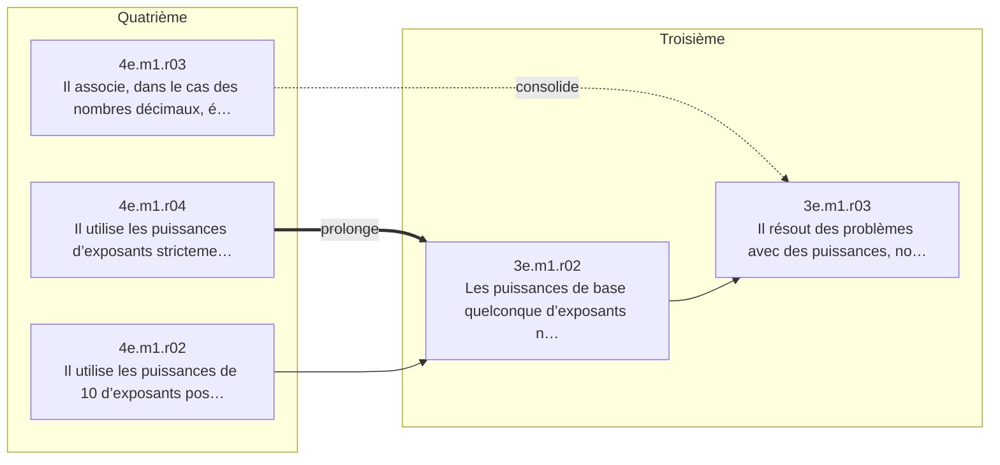

### Racine carrée — `racine-carree`

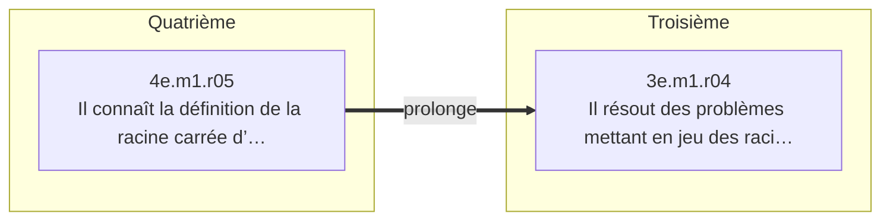

Prérequis venus d’autres fils : `4e.m4.r05`.

### Calcul littéral — `calcul-litteral`

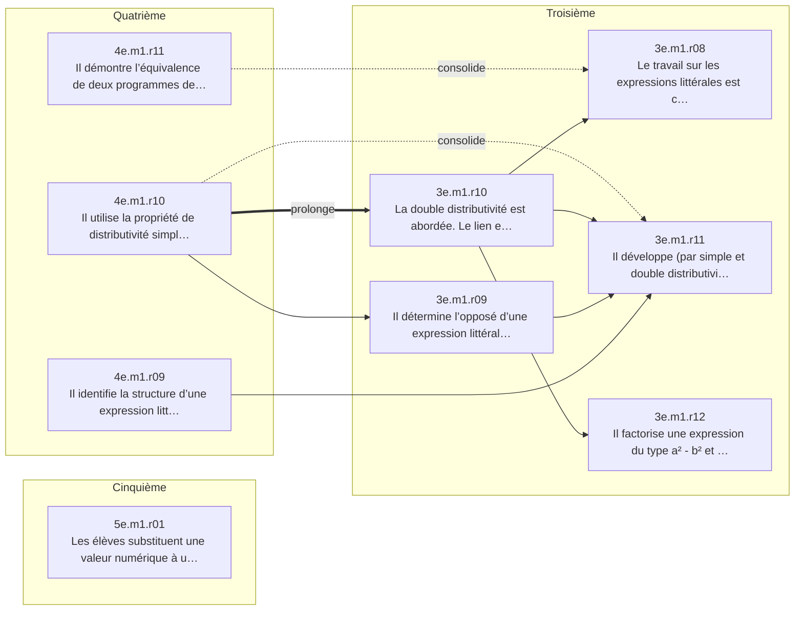

### Équations — `equations`

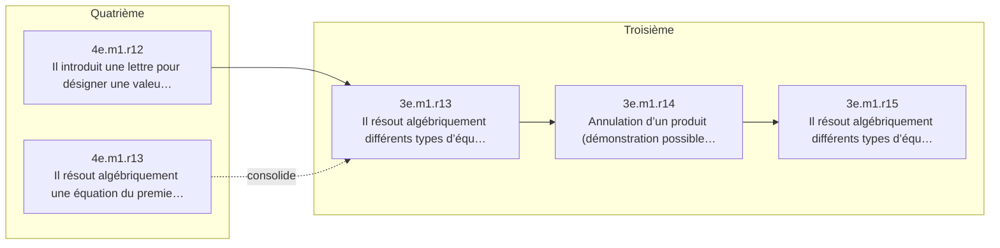

Prérequis venus d’autres fils : `3e.m1.r11`, `3e.m1.r12`, `4e.m1.r05`.

### Statistiques — `statistiques`

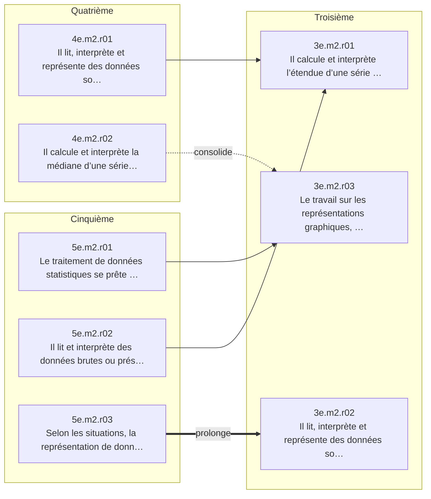

### Probabilités — `probabilites`

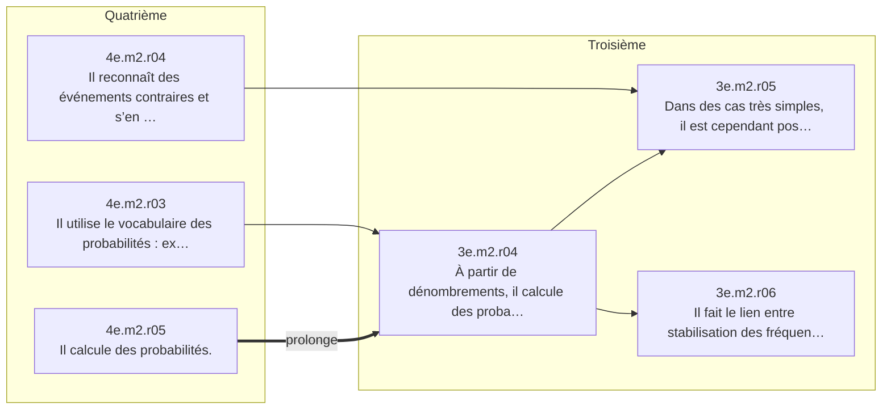

Prérequis venus d’autres fils : `3e.m2.r03`.

### Proportionnalité — `proportionnalite`

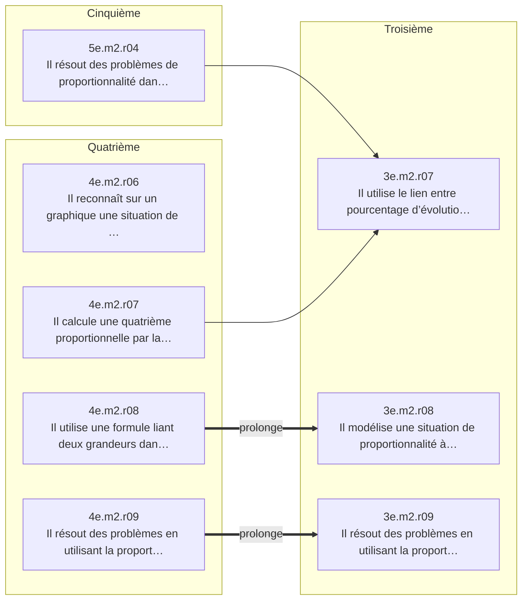

Prérequis venus d’autres fils : `3e.m2.r15`.

### Fonctions — `fonctions`

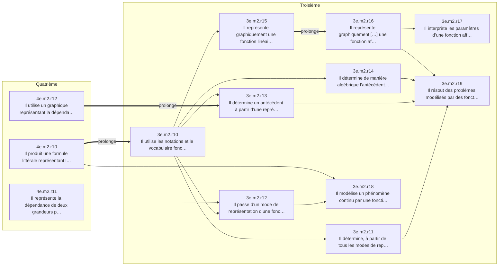

Prérequis venus d’autres fils : `5e.m1.r01`, `5e.m4.r01`, `3e.m1.r13`, `3e.m1.r14`, `4e.m2.r06`.

### Grandeurs composées, volumes — `grandeurs-volumes`

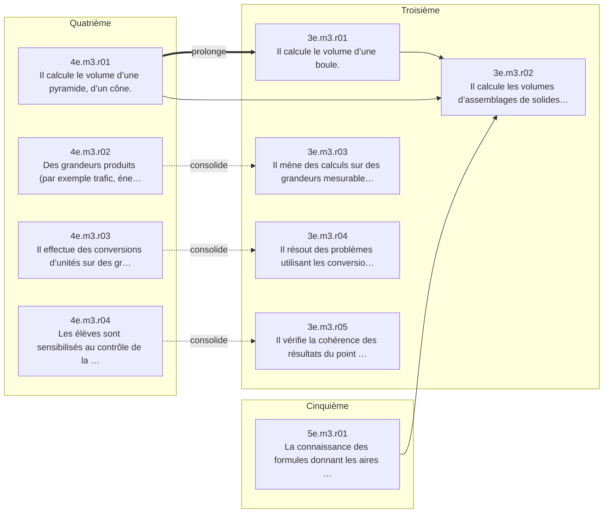

Prérequis venus d’autres fils : `4e.m1.r04`, `4e.m1.r02`.

### Thalès, agrandissement, triangles semblables — `thales-similitude`

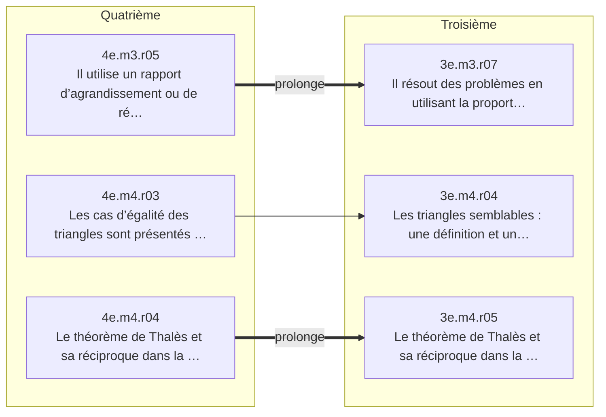

Prérequis venus d’autres fils : `3e.m2.r09`, `4e.m2.r07`, `5e.m4.r02`, `5e.m4.r03`.

### Pythagore et trigonométrie — `trigonometrie`

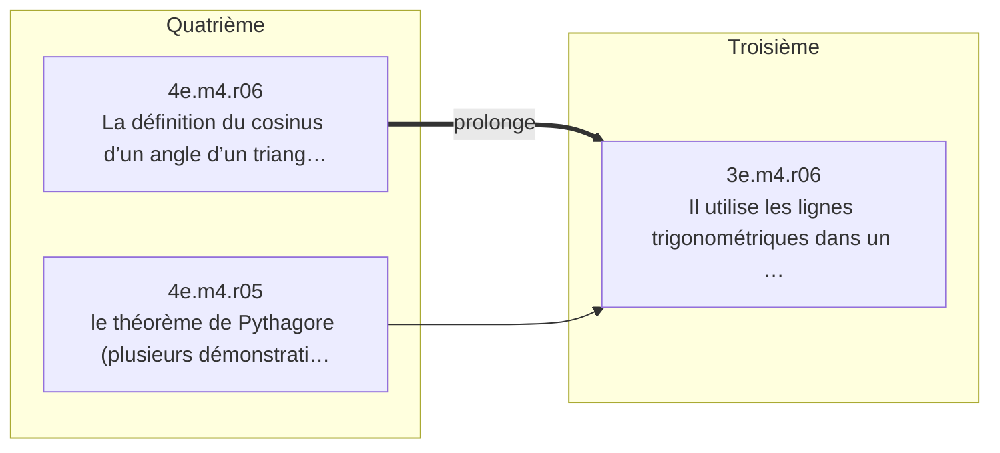

### Transformations — `transformations`

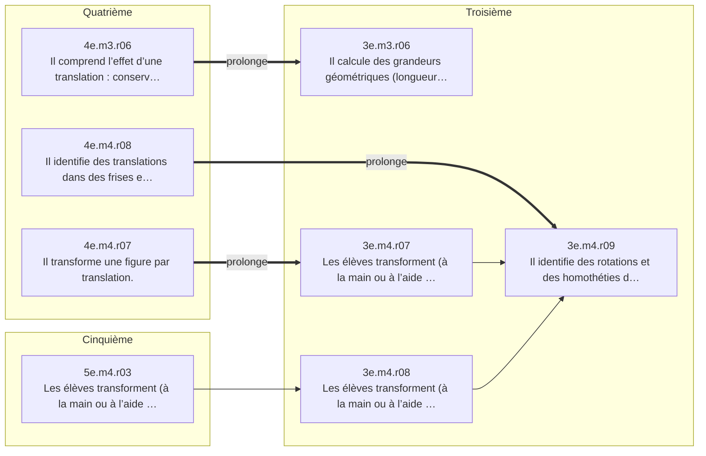

Prérequis venus d’autres fils : `6e.m3.r01`, `4e.m3.r05`, `3e.m4.r05`.

### Angles, figures et démonstration — `geometrie-raisonnement`

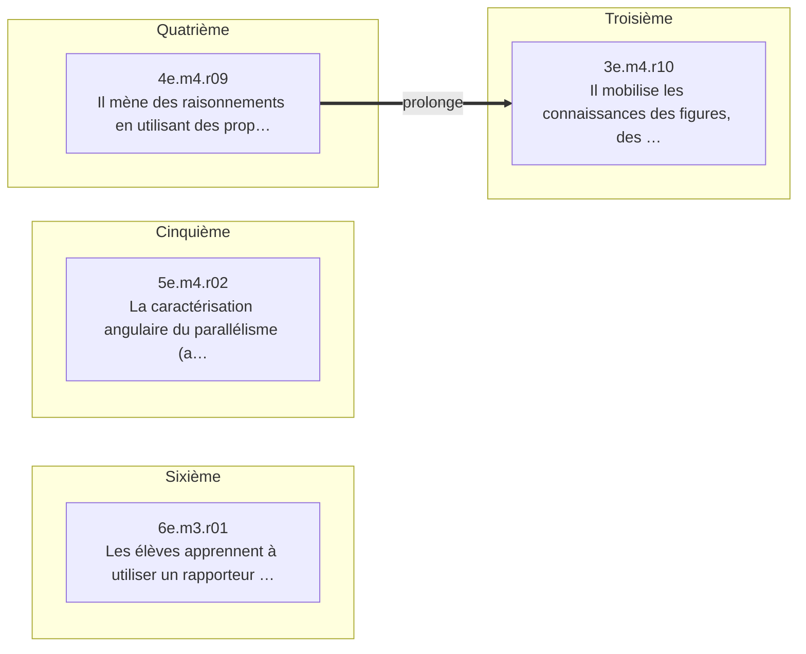

Prérequis venus d’autres fils : `3e.m4.r05`, `3e.m4.r04`, `3e.m4.r07`, `3e.m4.r08`.

### Repérage et représentation de l’espace — `espace`

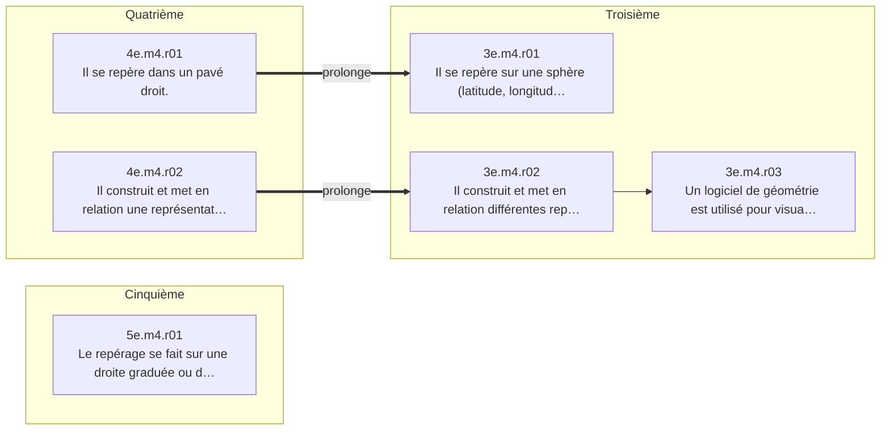

Prérequis venus d’autres fils : `4e.m3.r05`.

### Algorithmique et programmation — `algorithmique`

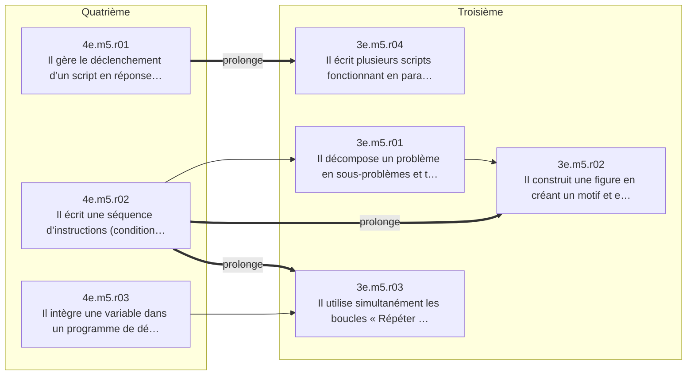

Prérequis venus d’autres fils : `3e.m2.r06`.

## 2. Le programme, séquence par séquence

### Sixième (`6e`)

#### Séquence 3 — Grandeurs et mesures (`6e.m3`)

| item | texte du programme | leçon d’accueil | part de |
|---|---|---|---|
| `6e.m3.r01` | Les élèves apprennent à utiliser un rapporteur pour mesurer un angle en degrés ou construire un angle de mesure donnée en degrés. | — _(pas encore de leçon en 6e)_ | — |

### Cinquième (`5e`)

#### Séquence 1 — Thème A – Nombres et calculs (`5e.m1`)

| item | texte du programme | leçon d’accueil | part de |
|---|---|---|---|
| `5e.m1.r01` | Les élèves substituent une valeur numérique à une lettre pour calculer la valeur d’une expression littérale. | — _(pas encore de leçon en 5e)_ | — |

#### Séquence 2 — Thème B – Organisation et gestion de données, fonctions (`5e.m2`)

| item | texte du programme | leçon d’accueil | part de |
|---|---|---|---|
| `5e.m2.r01` | Le traitement de données statistiques se prête à des calculs d’effectifs, de fréquences et de moyennes. | — _(pas encore de leçon en 5e)_ | — |
| `5e.m2.r02` | Il lit et interprète des données brutes ou présentées sous forme de tableaux, de diagrammes et de graphiques. | — _(pas encore de leçon en 5e)_ | — |
| `5e.m2.r03` | Selon les situations, la représentation de données statistiques sous forme de tableaux, de diagrammes ou de graphiques est réalisée à la main ou à l’aide d’un tableur-grapheur. | — _(pas encore de leçon en 5e)_ | — |
| `5e.m2.r04` | Il résout des problèmes de proportionnalité dans diverses situations pouvant faire intervenir des pourcentages ou des échelles. | — _(pas encore de leçon en 5e)_ | — |

#### Séquence 3 — Thème C – Grandeurs et mesures (`5e.m3`)

| item | texte du programme | leçon d’accueil | part de |
|---|---|---|---|
| `5e.m3.r01` | La connaissance des formules donnant les aires du rectangle, du triangle et du disque, ainsi que le volume du pavé droit est entretenue à travers la résolution de problèmes. Elle est enrichie par celles de l’aire du parallélogramme, du volume du prisme et du cylindre. | — _(pas encore de leçon en 5e)_ | — |

#### Séquence 4 — Thème D - Espace et géométrie (`5e.m4`)

| item | texte du programme | leçon d’accueil | part de |
|---|---|---|---|
| `5e.m4.r01` | Le repérage se fait sur une droite graduée ou dans le plan muni d’un repère orthogonal. | — _(pas encore de leçon en 5e)_ | — |
| `5e.m4.r02` | La caractérisation angulaire du parallélisme (angles alternes-internes et angles correspondants) est énoncée. | — _(pas encore de leçon en 5e)_ | — |
| `5e.m4.r03` | Les élèves transforment (à la main ou à l’aide d’un logiciel) une figure par symétrie centrale. | — _(pas encore de leçon en 5e)_ | — |

### Quatrième (`4e`)

#### Séquence 1 — Thème A – Nombres et calculs (`4e.m1`)

| item | texte du programme | leçon d’accueil | part de |
|---|---|---|---|
| `4e.m1.r01` | Il calcule avec les nombres rationnels : addition, soustraction, multiplication, division. | — _(pas encore de leçon en 4e)_ | — |
| `4e.m1.r02` | Il utilise les puissances de 10 d’exposants positifs ou négatifs. | — _(pas encore de leçon en 4e)_ | — |
| `4e.m1.r03` | Il associe, dans le cas des nombres décimaux, écriture décimale, écriture fractionnaire et notation scientifique. | — _(pas encore de leçon en 4e)_ | — |
| `4e.m1.r04` | Il utilise les puissances d’exposants strictement positifs d’un nombre pour simplifier l’écriture des produits. | — _(pas encore de leçon en 4e)_ | — |
| `4e.m1.r05` | Il connaît la définition de la racine carrée d’un nombre positif. | — _(pas encore de leçon en 4e)_ | — |
| `4e.m1.r06` | Il décompose un nombre entier en produit de facteurs premiers. | — _(pas encore de leçon en 4e)_ | — |
| `4e.m1.r07` | Il utilise les nombres premiers inférieurs à 100 pour : reconnaître et produire des fractions égales ; simplifier des fractions. (reconnaître et produire des fractions égales ; simplifier des fractions) | — _(pas encore de leçon en 4e)_ | — |
| `4e.m1.r08` | Il modélise et résout des problèmes simples mettant en jeu les notions de divisibilité et de nombre premier. | — _(pas encore de leçon en 4e)_ | — |
| `4e.m1.r09` | Il identifie la structure d’une expression littérale (somme, produit). | — _(pas encore de leçon en 4e)_ | — |
| `4e.m1.r10` | Il utilise la propriété de distributivité simple pour développer un produit, factoriser une somme ou réduire une expression littérale. | — _(pas encore de leçon en 4e)_ | — |
| `4e.m1.r11` | Il démontre l’équivalence de deux programmes de calcul. | — _(pas encore de leçon en 4e)_ | — |
| `4e.m1.r12` | Il introduit une lettre pour désigner une valeur inconnue et met un problème en équation. | — _(pas encore de leçon en 4e)_ | — |
| `4e.m1.r13` | Il résout algébriquement une équation du premier degré. | — _(pas encore de leçon en 4e)_ | — |

#### Séquence 2 — Thème B – Organisation et gestion de données, fonctions (`4e.m2`)

| item | texte du programme | leçon d’accueil | part de |
|---|---|---|---|
| `4e.m2.r01` | Il lit, interprète et représente des données sous forme de diagrammes circulaires. | — _(pas encore de leçon en 4e)_ | — |
| `4e.m2.r02` | Il calcule et interprète la médiane d’une série de données de petit effectif total. | — _(pas encore de leçon en 4e)_ | — |
| `4e.m2.r03` | Il utilise le vocabulaire des probabilités : expérience aléatoire, issues, événement, probabilité, événement certain, événement impossible, événement contraire. | — _(pas encore de leçon en 4e)_ | — |
| `4e.m2.r04` | Il reconnaît des événements contraires et s’en sert pour calculer des probabilités. | — _(pas encore de leçon en 4e)_ | — |
| `4e.m2.r05` | Il calcule des probabilités. | — _(pas encore de leçon en 4e)_ | — |
| `4e.m2.r06` | Il reconnaît sur un graphique une situation de proportionnalité ou de non proportionnalité. | — _(pas encore de leçon en 4e)_ | — |
| `4e.m2.r07` | Il calcule une quatrième proportionnelle par la procédure de son choix. | — _(pas encore de leçon en 4e)_ | — |
| `4e.m2.r08` | Il utilise une formule liant deux grandeurs dans une situation de proportionnalité. | — _(pas encore de leçon en 4e)_ | — |
| `4e.m2.r09` | Il résout des problèmes en utilisant la proportionnalité dans le cadre de la géométrie. | — _(pas encore de leçon en 4e)_ | — |
| `4e.m2.r10` | Il produit une formule littérale représentant la dépendance de deux grandeurs. | — _(pas encore de leçon en 4e)_ | — |
| `4e.m2.r11` | Il représente la dépendance de deux grandeurs par un graphique. | — _(pas encore de leçon en 4e)_ | — |
| `4e.m2.r12` | Il utilise un graphique représentant la dépendance de deux grandeurs pour lire et interpréter différentes valeurs sur l’axe des abscisses ou l’axe des ordonnées. | — _(pas encore de leçon en 4e)_ | — |

#### Séquence 3 — Thème C – Grandeurs et mesures (`4e.m3`)

| item | texte du programme | leçon d’accueil | part de |
|---|---|---|---|
| `4e.m3.r01` | Il calcule le volume d’une pyramide, d’un cône. | — _(pas encore de leçon en 4e)_ | — |
| `4e.m3.r02` | Des grandeurs produits (par exemple trafic, énergie) et des grandeurs quotients (par exemple vitesse, débit, concentration, masse volumique) sont introduites à travers la résolution de problèmes. | — _(pas encore de leçon en 4e)_ | — |
| `4e.m3.r03` | Il effectue des conversions d’unités sur des grandeurs composées. | — _(pas encore de leçon en 4e)_ | — |
| `4e.m3.r04` | Les élèves sont sensibilisés au contrôle de la cohérence des résultats du point de vue des unités des grandeurs composées. | — _(pas encore de leçon en 4e)_ | — |
| `4e.m3.r05` | Il utilise un rapport d’agrandissement ou de réduction pour calculer, des longueurs, des aires, des volumes. | — _(pas encore de leçon en 4e)_ | — |
| `4e.m3.r06` | Il comprend l’effet d’une translation : conservation du parallélisme, des longueurs, des aires et des angles. | — _(pas encore de leçon en 4e)_ | — |

#### Séquence 4 — Thème D - Espace et géométrie (`4e.m4`)

| item | texte du programme | leçon d’accueil | part de |
|---|---|---|---|
| `4e.m4.r01` | Il se repère dans un pavé droit. | — _(pas encore de leçon en 4e)_ | — |
| `4e.m4.r02` | Il construit et met en relation une représentation en perspective cavalière et un patron d’une pyramide, d’un cône de révolution. | — _(pas encore de leçon en 4e)_ | — |
| `4e.m4.r03` | Les cas d’égalité des triangles sont présentés et utilisés pour résoudre des problèmes. | — _(pas encore de leçon en 4e)_ | — |
| `4e.m4.r04` | Le théorème de Thalès et sa réciproque dans la configuration des triangles emboîtés sont énoncés et utilisés | — _(pas encore de leçon en 4e)_ | — |
| `4e.m4.r05` | le théorème de Pythagore (plusieurs démonstrations possibles) et sa réciproque. | — _(pas encore de leçon en 4e)_ | — |
| `4e.m4.r06` | La définition du cosinus d’un angle d’un triangle rectangle découle, grâce au théorème de Thalès, de l’indépendance du rapport des longueurs le définissant. | — _(pas encore de leçon en 4e)_ | — |
| `4e.m4.r07` | Il transforme une figure par translation. | — _(pas encore de leçon en 4e)_ | — |
| `4e.m4.r08` | Il identifie des translations dans des frises et des pavages. | — _(pas encore de leçon en 4e)_ | — |
| `4e.m4.r09` | Il mène des raisonnements en utilisant des propriétés des figures, des configurations et de la translation. | — _(pas encore de leçon en 4e)_ | — |

#### Séquence 5 — Thème E – Algorithmique et programmation (`4e.m5`)

| item | texte du programme | leçon d’accueil | part de |
|---|---|---|---|
| `4e.m5.r01` | Il gère le déclenchement d’un script en réponse à un événement. | — _(pas encore de leçon en 4e)_ | — |
| `4e.m5.r02` | Il écrit une séquence d’instructions (condition « si … alors » et boucle « répéter … fois »). | — _(pas encore de leçon en 4e)_ | — |
| `4e.m5.r03` | Il intègre une variable dans un programme de déplacement, de construction géométrique ou de calcul. | — _(pas encore de leçon en 4e)_ | — |

### Troisième (`3e`)

#### Séquence 1 — Thème A – Nombres et calculs (`3e.m1`)

| item | texte du programme | leçon d’accueil | part de |
|---|---|---|---|
| `3e.m1.r01` | Il calcule avec les nombres rationnels, notamment dans le cadre de résolution de problèmes. | `calculer-avec-des-fractions` _(prévue)_ | consolide `4e.m1.r01`, `3e.m1.r06` |
| `3e.m1.r02` | Les puissances de base quelconque d’exposants négatifs sont introduites et utilisées pour simplifier des quotients. | `puissances-d-exposant-negatif` _(prévue)_ | prolonge `4e.m1.r04`, `4e.m1.r02` |
| `3e.m1.r03` | Il résout des problèmes avec des puissances, notamment en utilisant la notation scientifique. | `notation-scientifique-en-probleme` _(prévue)_ | consolide `4e.m1.r03`, `3e.m1.r02` |
| `3e.m1.r04` | Il résout des problèmes mettant en jeu des racines carrées. | `racine-carree-en-probleme` _(prévue)_ | prolonge `4e.m1.r05`, `4e.m4.r05` |
| `3e.m1.r05` | Il décompose un nombre entier en produit de facteurs premiers (à la main, à l’aide d’un tableur ou d’un logiciel de programmation). | `decomposer-en-facteurs-premiers` | prolonge `4e.m1.r06` |
| `3e.m1.r06` | Il simplifie une fraction pour la rendre irréductible. | `fraction-irreductible` | `3e.m1.r05`, prolonge `4e.m1.r07`, `3e.m1.r07` |
| `3e.m1.r07` | Il modélise et résout des problèmes mettant en jeu la divisibilité (engrenages, conjonction de phénomènes…). | `trouver-le-pgcd` | `3e.m1.r05`, prolonge `4e.m1.r08` |
| `3e.m1.r08` | Le travail sur les expressions littérales est consolidé avec des transformations d’expressions, des programmes de calcul, des mises en équations, des fonctions… | `prouver-avec-le-calcul-litteral` _(prévue)_ | consolide `4e.m1.r11`, `3e.m1.r10` |
| `3e.m1.r09` | Il détermine l’opposé d’une expression littérale. | `oppose-d-une-expression` _(prévue)_ | `4e.m1.r10` |
| `3e.m1.r10` | La double distributivité est abordée. Le lien est fait avec la simple distributivité. | `double-distributivite` _(prévue)_ | prolonge `4e.m1.r10` |
| `3e.m1.r11` | Il développe (par simple et double distributivités), factorise, réduit des expressions algébriques simples. | `double-distributivite` _(prévue)_ | consolide `4e.m1.r10`, `3e.m1.r10`, `3e.m1.r09`, `4e.m1.r09` |
| `3e.m1.r12` | Il factorise une expression du type a² - b² et développe des expression du type (a + b)(a - b). | `difference-de-deux-carres` _(prévue)_ | `3e.m1.r10` |
| `3e.m1.r13` | Il résout algébriquement différents types d’équations : équation du premier degré. | `mettre-un-probleme-en-equation` _(prévue)_ | `4e.m1.r12`, consolide `4e.m1.r13`, `3e.m1.r11` |
| `3e.m1.r14` | Annulation d’un produit (démonstration possible par disjonction de cas). | `equation-produit-nul` _(prévue)_ | `3e.m1.r13`, `3e.m1.r11`, `3e.m1.r12` |
| `3e.m1.r15` | Il résout algébriquement différents types d’équations : équations de la forme x² = a sur des exemples simples. | `equation-x-carre-egal-a` _(prévue)_ | `4e.m1.r05`, `3e.m1.r14` |

#### Séquence 2 — Thème B – Organisation et gestion de données, fonctions (`3e.m2`)

| item | texte du programme | leçon d’accueil | part de |
|---|---|---|---|
| `3e.m2.r01` | Il calcule et interprète l’étendue d’une série présentée sous forme de données brutes, d’un tableau, d’un diagramme en bâtons, d’un diagramme circulaire ou d’un histogramme. | `etendue-d-une-serie` _(prévue)_ | `5e.m2.r02`, `4e.m2.r01` |
| `3e.m2.r02` | Il lit, interprète et représente des données sous forme d’histogrammes pour des classes de même amplitude. | `histogramme` _(prévue)_ | prolonge `5e.m2.r03` |
| `3e.m2.r03` | Le travail sur les représentations graphiques, le calcul, en particulier celui des effectifs et des fréquences, et l’interprétation des indicateurs de position est consolidé. | `etendue-d-une-serie` _(prévue)_ | consolide `4e.m2.r02`, `5e.m2.r01` |
| `3e.m2.r04` | À partir de dénombrements, il calcule des probabilités pour des expériences aléatoires simples à une ou deux épreuves. | `probabilite-une-epreuve` _(prévue)_ | prolonge `4e.m2.r05`, `4e.m2.r03` |
| `3e.m2.r05` | Dans des cas très simples, il est cependant possible d’introduire des expériences à deux épreuves. Les dénombrements s’appuient alors uniquement sur des tableaux à double entrée, la notion d’arbre ne figurant pas au programme. | `probabilite-deux-epreuves` _(prévue)_ | `3e.m2.r04`, `4e.m2.r04` |
| `3e.m2.r06` | Il fait le lien entre stabilisation des fréquences et probabilités. | `frequence-et-probabilite` _(prévue)_ | `3e.m2.r04`, `3e.m2.r03` |
| `3e.m2.r07` | Il utilise le lien entre pourcentage d’évolution et coefficient multiplicateur. | `pourcentage-d-evolution` _(prévue)_ | `5e.m2.r04`, `4e.m2.r07` |
| `3e.m2.r08` | Il modélise une situation de proportionnalité à l’aide d’une fonction linéaire. | `fonction-lineaire` _(prévue)_ | prolonge `4e.m2.r08`, `3e.m2.r15` |
| `3e.m2.r09` | Il résout des problèmes en utilisant la proportionnalité dans le cadre de la géométrie. | `triangles-semblables` _(prévue)_ | prolonge `4e.m2.r09` |
| `3e.m2.r10` | Il utilise les notations et le vocabulaire fonctionnels. | `notion-de-fonction` _(prévue)_ | prolonge `4e.m2.r10`, `5e.m1.r01` |
| `3e.m2.r11` | Il détermine, à partir de tous les modes de représentation, l’image d’un nombre. | `notion-de-fonction` _(prévue)_ | `3e.m2.r10`, `5e.m1.r01` |
| `3e.m2.r12` | Il passe d’un mode de représentation d’une fonction à un autre. | `lire-une-fonction` _(prévue)_ | `3e.m2.r10`, `4e.m2.r11`, `5e.m4.r01` |
| `3e.m2.r13` | Il détermine un antécédent à partir d’une représentation graphique ou d’un tableau de valeurs d’une fonction. | `lire-une-fonction` _(prévue)_ | prolonge `4e.m2.r12`, `3e.m2.r10` |
| `3e.m2.r14` | Il détermine de manière algébrique l’antécédent par une fonction, dans des cas se ramenant à la résolution d’une équation du premier degré. | `antecedent-par-le-calcul` _(prévue)_ | `3e.m1.r13`, `3e.m2.r10`, `3e.m1.r14` |
| `3e.m2.r15` | Il représente graphiquement une fonction linéaire […]. | `fonction-lineaire` _(prévue)_ | `3e.m2.r10`, `5e.m4.r01`, `4e.m2.r06` |
| `3e.m2.r16` | Il représente graphiquement […] une fonction affine. | `fonction-affine` _(prévue)_ | prolonge `3e.m2.r15` |
| `3e.m2.r17` | Il interprète les paramètres d’une fonction affine suivant l’allure de sa courbe représentative. | `fonction-affine` _(prévue)_ | `3e.m2.r16` |
| `3e.m2.r18` | Il modélise un phénomène continu par une fonction. | `modeliser-avec-une-fonction` _(prévue)_ | `3e.m2.r12`, `4e.m2.r10` |
| `3e.m2.r19` | Il résout des problèmes modélisés par des fonctions en utilisant un ou plusieurs modes de représentation. | `modeliser-avec-une-fonction` _(prévue)_ | `3e.m2.r11`, `3e.m2.r13`, `3e.m2.r14`, `3e.m2.r16` |

#### Séquence 3 — Thème C – Grandeurs et mesures (`3e.m3`)

| item | texte du programme | leçon d’accueil | part de |
|---|---|---|---|
| `3e.m3.r01` | Il calcule le volume d’une boule. | `volume-boule-et-assemblages` _(prévue)_ | prolonge `4e.m3.r01`, `4e.m1.r04` |
| `3e.m3.r02` | Il calcule les volumes d’assemblages de solides étudiés au cours du cycle. | `volume-boule-et-assemblages` _(prévue)_ | `3e.m3.r01`, `4e.m3.r01`, `5e.m3.r01` |
| `3e.m3.r03` | Il mène des calculs sur des grandeurs mesurables, notamment des grandeurs composées, et exprime les résultats dans les unités adaptées. | `grandeurs-composees` _(prévue)_ | consolide `4e.m3.r02` |
| `3e.m3.r04` | Il résout des problèmes utilisant les conversions d’unités sur des grandeurs composées. | `conversions-grandeurs-composees` _(prévue)_ | consolide `4e.m3.r03`, `4e.m1.r02` |
| `3e.m3.r05` | Il vérifie la cohérence des résultats du point de vue des unités pour les calculs de grandeurs simples ou composées. | `grandeurs-composees` _(prévue)_ | consolide `4e.m3.r04` |
| `3e.m3.r06` | Il calcule des grandeurs géométriques (longueurs, aires et volumes) en utilisant les transformations (symétries, rotations, translations, homothétie). | `rotation` _(prévue)_ | prolonge `4e.m3.r06` |
| `3e.m3.r07` | Il résout des problèmes en utilisant la proportionnalité en géométrie dans le cadre de certaines configurations ou transformations (agrandissement, réduction, triangles semblables, homothéties). | `effet-d-une-homothetie` _(prévue)_ | prolonge `4e.m3.r05`, `3e.m2.r09` |

#### Séquence 4 — Thème D - Espace et géométrie (`3e.m4`)

| item | texte du programme | leçon d’accueil | part de |
|---|---|---|---|
| `3e.m4.r01` | Il se repère sur une sphère (latitude, longitude). | `se-reperer-sur-une-sphere` _(prévue)_ | prolonge `4e.m4.r01` |
| `3e.m4.r02` | Il construit et met en relation différentes représentations des solides étudiés au cours du cycle (représentations en perspective cavalière, vues de face, de dessus, en coupe, patrons) et leurs sections planes. | `representations-des-solides` _(prévue)_ | prolonge `4e.m4.r02` |
| `3e.m4.r03` | Un logiciel de géométrie est utilisé pour visualiser des solides et leurs sections planes. | `sections-planes` _(prévue)_ | `3e.m4.r02`, `4e.m3.r05` |
| `3e.m4.r04` | Les triangles semblables : une définition et une propriété caractéristique. | `triangles-semblables` _(prévue)_ | `4e.m2.r07`, `4e.m4.r03`, `5e.m4.r02` |
| `3e.m4.r05` | Le théorème de Thalès et sa réciproque dans la configuration du papillon sont énoncés et utilisés (démonstration possible, utilisant une symétrie centrale pour se ramener à la configuration étudiée en quatrième). | `thales-configuration-papillon` | prolonge `4e.m4.r04`, `5e.m4.r03` |
| `3e.m4.r06` | Il utilise les lignes trigonométriques dans un triangle rectangle pour calculer des longueurs ou des mesures d’angles. | `cosinus-sinus-tangente` _(prévue)_ | prolonge `4e.m4.r06`, `4e.m4.r05` |
| `3e.m4.r07` | Les élèves transforment (à la main ou à l’aide d’un logiciel) une figure par rotation […]. Le lien est fait entre angle et rotation | `rotation` _(prévue)_ | prolonge `4e.m4.r07`, `6e.m3.r01` |
| `3e.m4.r08` | Les élèves transforment (à la main ou à l’aide d’un logiciel) une figure par […] homothétie (de rapport positif ou négatif). Le lien est fait […] entre le théorème de Thalès et les homothéties. | `homothetie` _(prévue)_ | `4e.m3.r05`, `5e.m4.r03`, `3e.m4.r05` |
| `3e.m4.r09` | Il identifie des rotations et des homothéties dans des frises, des pavages et des rosaces. | `frises-pavages-rosaces` _(prévue)_ | prolonge `4e.m4.r08`, `3e.m4.r07`, `3e.m4.r08` |
| `3e.m4.r10` | Il mobilise les connaissances des figures, des configurations, de la rotation et de l’homothétie pour déterminer des grandeurs géométriques. | `demontrer-en-geometrie` _(prévue)_ | prolonge `4e.m4.r09`, `3e.m4.r05`, `3e.m4.r04`, `3e.m4.r07`, `3e.m4.r08` |

#### Séquence 5 — Thème E – Algorithmique et programmation (`3e.m5`)

| item | texte du programme | leçon d’accueil | part de |
|---|---|---|---|
| `3e.m5.r01` | Il décompose un problème en sous-problèmes et traduit un sous-problème en créant un « bloc-personnalisé ». | `programmer-des-blocs-personnalises` _(prévue)_ | `4e.m5.r02` |
| `3e.m5.r02` | Il construit une figure en créant un motif et en le reproduisant à l’aide d’une boucle. | `programmer-des-blocs-personnalises` _(prévue)_ | prolonge `4e.m5.r02`, `3e.m5.r01` |
| `3e.m5.r03` | Il utilise simultanément les boucles « Répéter … fois » et « Répéter jusqu’à … » ainsi que les instructions conditionnelles pour réaliser des figures, des programmes de calculs, des déplacements, des simulations d’expérience aléatoire. | `boucles-et-conditions` _(prévue)_ | prolonge `4e.m5.r02`, `4e.m5.r03`, `3e.m2.r06` |
| `3e.m5.r04` | Il écrit plusieurs scripts fonctionnant en parallèle pour gérer des interactions et créer des jeux. | `scripts-en-parallele` _(prévue)_ | prolonge `4e.m5.r01` |

## 3. Les leçons et leurs items

### Sixième

_Aucune leçon._

### Cinquième

_Aucune leçon._

### Quatrième

_Aucune leçon._

### Troisième

| # | leçon | statut | items |
|---:|---|---|---|
| 1 | `decomposer-en-facteurs-premiers` — Décomposer un nombre en facteurs premiers | publiée | `3e.m1.r05` |
| 2 | `trouver-le-pgcd` — Trouver le PGCD de deux nombres | publiée | `3e.m1.r07` |
| 3 | `fraction-irreductible` — Rendre une fraction irréductible | publiée | `3e.m1.r06` |
| 4 | `multiples-et-diviseurs-communs` — Engrenages et rendez-vous : quand deux rythmes se retrouvent | publiée | `3e.m1.r07` |
| 5 | `vers-le-brevet-multiples-et-diviseurs` — Vers le brevet — Multiples et diviseurs | synthèse | — |
| 6 | `oppose-d-une-expression` — L’opposé d’une expression et les parenthèses | prévue | `3e.m1.r09` |
| 7 | `double-distributivite` — Développer un produit de deux sommes | prévue | `3e.m1.r10` `3e.m1.r11` |
| 8 | `difference-de-deux-carres` — Factoriser une différence de deux carrés | prévue | `3e.m1.r12` |
| 9 | `prouver-avec-le-calcul-litteral` — Prouver avec des lettres : programmes de calcul | prévue | `3e.m1.r08` |
| 10 | `vers-le-brevet-developper-et-factoriser` — Vers le brevet — Développer et factoriser | synthèse | — |
| 11 | `triangles-semblables` — Reconnaître des triangles semblables | prévue | `3e.m4.r04` `3e.m2.r09` |
| 12 | `thales-configuration-papillon` — Thalès dans le papillon | publiée | `3e.m4.r05` `3e.m2.r09` |
| 13 | `reciproque-de-thales` — Prouver que deux droites sont parallèles | prévue | `3e.m4.r05` |
| 14 | `vers-le-brevet-thales-et-triangles-semblables` — Vers le brevet — Thalès et triangles semblables | synthèse | — |
| 15 | `calculer-avec-des-fractions` — Résoudre des problèmes avec des fractions | prévue | `3e.m1.r01` |
| 16 | `mettre-un-probleme-en-equation` — Mettre un problème en équation | prévue | `3e.m1.r13` |
| 17 | `equation-produit-nul` — Résoudre une équation produit nul | prévue | `3e.m1.r14` |
| 18 | `equation-x-carre-egal-a` — Résoudre l’équation x² = a | prévue | `3e.m1.r15` |
| 19 | `vers-le-brevet-resoudre-des-equations` — Vers le brevet — Résoudre des équations | synthèse | — |
| 20 | `notion-de-fonction` — Qu’est-ce qu’une fonction ? Image et antécédent | prévue | `3e.m2.r10` `3e.m2.r11` |
| 21 | `lire-une-fonction` — Lire une fonction dans un tableau ou sur une courbe | prévue | `3e.m2.r12` `3e.m2.r11` `3e.m2.r13` |
| 22 | `antecedent-par-le-calcul` — Trouver un antécédent par le calcul | prévue | `3e.m2.r14` |
| 23 | `vers-le-brevet-la-notion-de-fonction` — Vers le brevet — La notion de fonction | synthèse | — |
| 24 | `puissances-d-exposant-negatif` — Les puissances d’exposant négatif | prévue | `3e.m1.r02` |
| 25 | `notation-scientifique-en-probleme` — Très grand, très petit : la notation scientifique | prévue | `3e.m1.r03` |
| 26 | `racine-carree-en-probleme` — Utiliser la racine carrée pour calculer une longueur | prévue | `3e.m1.r04` |
| 27 | `vers-le-brevet-puissances-et-racines` — Vers le brevet — Puissances et racine carrée | synthèse | — |
| 28 | `cosinus-sinus-tangente` — Cosinus, sinus et tangente d’un angle | prévue | `3e.m4.r06` |
| 29 | `calculer-un-angle` — Calculer un angle dans un triangle rectangle | prévue | `3e.m4.r06` |
| 30 | `resoudre-un-triangle-rectangle` — Résoudre un triangle rectangle | prévue | `3e.m4.r06` |
| 31 | `vers-le-brevet-trigonometrie` — Vers le brevet — Trigonométrie | synthèse | — |
| 32 | `fonction-lineaire` — Fonction linéaire et proportionnalité | prévue | `3e.m2.r15` `3e.m2.r08` |
| 33 | `fonction-affine` — Fonction affine et sa droite | prévue | `3e.m2.r16` `3e.m2.r17` |
| 34 | `pourcentage-d-evolution` — Augmenter ou baisser d’un pourcentage | prévue | `3e.m2.r07` |
| 35 | `modeliser-avec-une-fonction` — Choisir une fonction pour résoudre un problème | prévue | `3e.m2.r18` `3e.m2.r19` |
| 36 | `vers-le-brevet-fonctions-lineaires-et-affines` — Vers le brevet — Fonctions linéaires et affines | synthèse | — |
| 37 | `etendue-d-une-serie` — Comparer des séries : moyenne, médiane, étendue | prévue | `3e.m2.r01` `3e.m2.r03` |
| 38 | `histogramme` — Lire et tracer un histogramme | prévue | `3e.m2.r02` `3e.m2.r03` |
| 39 | `probabilite-une-epreuve` — Calculer une probabilité en comptant les issues | prévue | `3e.m2.r04` |
| 40 | `probabilite-deux-epreuves` — Deux tirages : le tableau à double entrée | prévue | `3e.m2.r05` |
| 41 | `frequence-et-probabilite` — Simuler le hasard : fréquences et probabilité | prévue | `3e.m2.r06` |
| 42 | `vers-le-brevet-statistiques-et-probabilites` — Vers le brevet — Statistiques et probabilités | synthèse | — |
| 43 | `programmer-des-blocs-personnalises` — Découper un programme en blocs | prévue | `3e.m5.r01` `3e.m5.r02` |
| 44 | `boucles-et-conditions` — Boucles « jusqu’à » et conditions | prévue | `3e.m5.r03` |
| 45 | `scripts-en-parallele` — Faire interagir des lutins | prévue | `3e.m5.r04` |
| 46 | `vers-le-brevet-programmer-avec-des-blocs` — Vers le brevet — Programmer : blocs, boucles et scripts | synthèse | — |
| 47 | `rotation` — Faire tourner une figure : la rotation | prévue | `3e.m4.r07` `3e.m3.r06` |
| 48 | `homothetie` — Agrandir depuis un point : l’homothétie | prévue | `3e.m4.r08` |
| 49 | `effet-d-une-homothetie` — Longueurs, aires et volumes après une homothétie | prévue | `3e.m3.r07` `3e.m4.r08` |
| 50 | `frises-pavages-rosaces` — Frises, pavages et rosaces | prévue | `3e.m4.r09` |
| 51 | `demontrer-en-geometrie` — Rédiger une démonstration en géométrie | prévue | `3e.m4.r10` |
| 52 | `vers-le-brevet-rotations-et-homotheties` — Vers le brevet — Rotations et homothéties | synthèse | — |
| 53 | `volume-boule-et-assemblages` — Volume d’une boule et de solides assemblés | prévue | `3e.m3.r01` `3e.m3.r02` |
| 54 | `grandeurs-composees` — Vitesse, débit, masse volumique | prévue | `3e.m3.r03` `3e.m3.r05` |
| 55 | `conversions-grandeurs-composees` — Convertir des vitesses, des débits et des volumes | prévue | `3e.m3.r04` `3e.m3.r05` |
| 56 | `vers-le-brevet-grandeurs-et-volumes` — Vers le brevet — Vitesses, débits et volumes | synthèse | — |
| 57 | `se-reperer-sur-une-sphere` — Se repérer sur une sphère : latitude et longitude | prévue | `3e.m4.r01` |
| 58 | `representations-des-solides` — Patrons, perspective et vues d’un solide | prévue | `3e.m4.r02` |
| 59 | `sections-planes` — Couper un solide : les sections planes | prévue | `3e.m4.r03` |
| 60 | `vers-le-brevet-representer-l-espace` — Vers le brevet — Représenter l’espace | synthèse | — |

